# Ajolotito Hambriento

Mascota virtual en Flutter para aprender **notificaciones locales bien hechas**: permisos en contexto, canales de Android, programación con zona horaria, horas de silencio, tope diario, toques en la notificación y pruebas con **TDD**.

**Materia:** Desarrollo Móvil Integral · UTNG
**Profesor:** Anastacio Rodríguez García
**Alumno:** José Alejandro Olvera Lugo
**Grupo:** GTID244

---

## ¿Qué hace la app?

Un ajolote (Xólotl) cuya **saciedad baja con el tiempo**. Cuando le da hambre, la app avisa con una notificación local. El juego es el pretexto; lo importante es cómo se hacen bien las notificaciones:

- Pide el permiso **en contexto** (con una explicación propia antes del diálogo del sistema) y **una sola vez**.
- Un canal de Android por tipo de aviso: *Hambre del ajolote* y *Sorpresas y juegos*.
- **Horas de silencio** de 10 pm a 8 am y tope de 3 avisos al día.
- Ids fijos: al dar de comer, el aviso viejo se reemplaza y no quedan avisos obsoletos.
- No avisa del hambre si el usuario está viendo la app.
- Botón **"Dar de comer 🍤"** dentro de la notificación.
- Payload versionado (`v1:...`) que se valida: si llega algo raro, la app abre en el inicio.
- **Modo clase**: 1 hora de vida pasa en 1 minuto, para ver los avisos sin esperar horas.

## Tecnologías

| Paquete | Uso |
|---|---|
| `flutter_local_notifications` | Notificaciones locales |
| `timezone` | Programar con zona horaria (America/Mexico_City) |
| `shared_preferences` | Guardar al ajolote y los ajustes |
| `app_settings` | Abrir los ajustes de notificaciones del sistema |
| `flutter_test` | Pruebas unitarias y de widgets |

# Evidencia de TDD

Cada ronda sigue el ciclo ** ROJO →  VERDE**:

- ** ROJO:** se tiene la prueba, pero la implementación no está disponible, así que la prueba **falla** (errores como `Undefined name` o `Method not found`).
- ** VERDE:** con la implementación en su lugar, la prueba **pasa**.

## Ronda 2 · El reloj y el ajolote (`mascota_test.dart`)

Pruebas de saciedad, humor (con fronteras en 40 y 15), predicción de cuándo tendrá hambre, alimentar y guardado en JSON.

** Rojo**

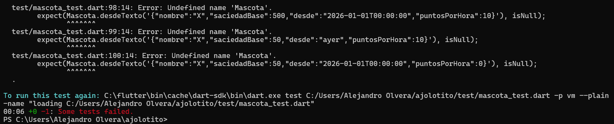

** Verde** (16 pruebas)

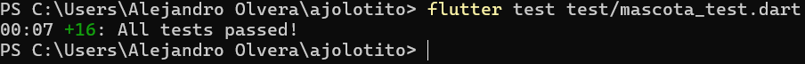

## Ronda 4 · Política y payload (`politica_payload_test.dart`)

Horas de silencio que cruzan la medianoche, mover el aviso al final del silencio y payload versionado.

** Rojo**

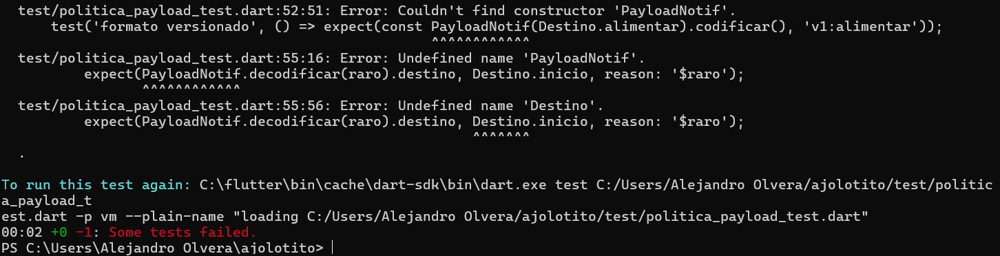

** Verde** (12 pruebas)

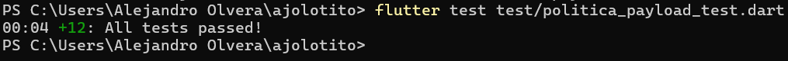

## Ronda 6 · Planificador (`planificador_test.dart`)

De qué manera el estado del ajolote se convierte en la agenda de avisos: silencio, colapso de avisos juntos, categorías apagadas y tope diario.

** Rojo**

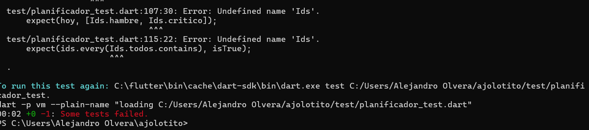

** Verde** (13 pruebas)

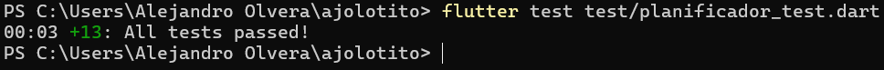

## Ronda 8 · Permiso (`permiso_test.dart`)

Pedir el permiso una sola vez y, si el usuario dice que no, guiarlo a Ajustes sin insistir. Usa el doble de pruebas `falsos.dart` (Ronda 7).

** Rojo**

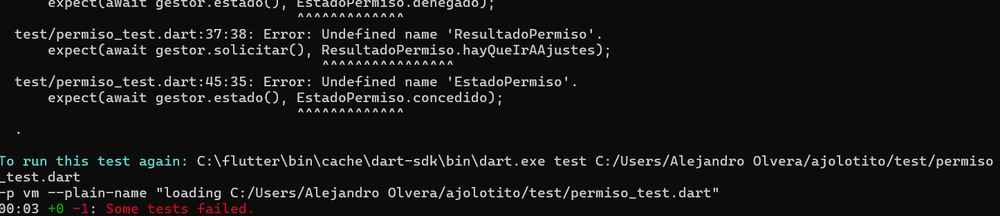

** Verde** (6 pruebas)

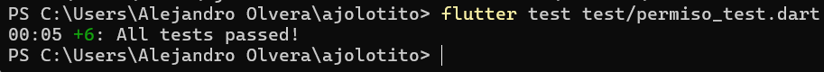

## Ronda 9 · Servicio (`servicio_test.dart`)

Sincronizar lo programado con el estado real: sin duplicados, sin permiso no se programa nada, primer plano contra segundo plano, preferencias y modo clase.

** Rojo**

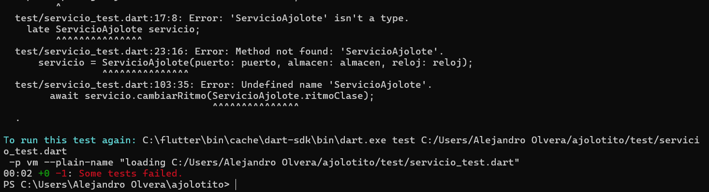

** Verde** (14 pruebas)

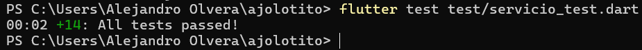

## Ronda 11 · ViewModel y pantalla (`vm_test.dart` y `pantalla_test.dart`)

Comportamientos que percibe el usuario: no pedir permiso al abrir, pedirlo tras explicar, toques en la notificación y ciclo de vida de la app.

** Rojo**

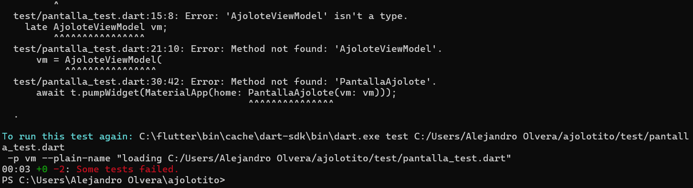

** Verde** (13 pruebas)

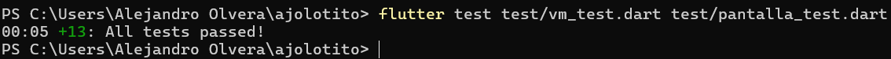

## Resultado final: todas las pruebas

Con las 7 suites de pruebas en el proyecto se ejecuta `flutter test`:

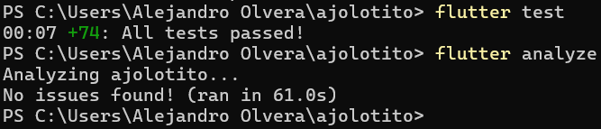

| Ronda | Archivo de prueba | Pruebas |
|---|---|---|
| 2 | `mascota_test.dart` | 16 |
| 4 | `politica_payload_test.dart` | 12 |
| 6 | `planificador_test.dart` | 13 |
| 8 | `permiso_test.dart` | 6 |
| 9 | `servicio_test.dart` | 14 |
| 11 | `vm_test.dart` + `pantalla_test.dart` | 13 |
| | **Total** | **74**  |

---

# La app funcionando en el teléfono

Probada en un dispositivo Android real (ASUS).

### Pantalla principal

El ajolote feliz con la saciedad al 100, el botón **Dar de comer**, los avisos activados con los próximos programados y el interruptor del **Modo clase**.

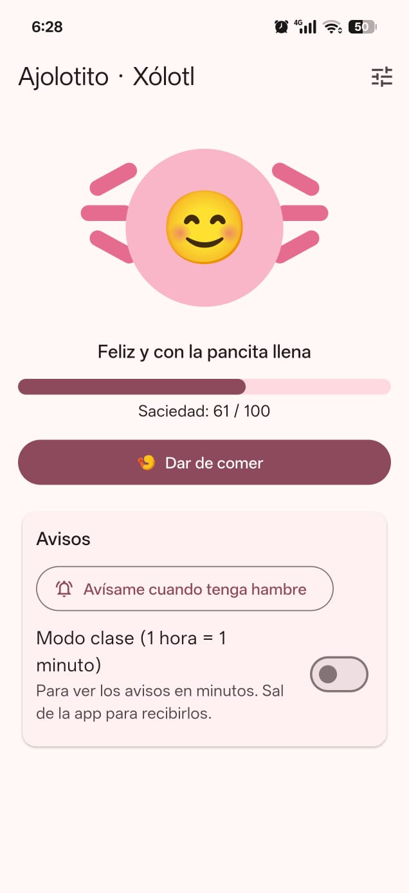

### Ajustes de avisos

El usuario manda: cada tipo de aviso (*Hambre del ajolote* y *Sorpresas y juegos*) se puede apagar por separado, y se indica el silencio automático de 10 pm a 8 am.

### Notificación de prueba

Al tocar **"Probar una notificación ahora"** aparece al instante la notificación de Xólotl.

# Lista de verificación

- [x] `flutter test` pasa en verde (74 pruebas en 7 archivos).
- [x] El permiso se pide tras una explicación propia, solo una vez.
- [x] Cada tipo de aviso se puede apagar por separado.
- [x] La notificación de prueba aparece al instante.
- [x] La notificación de hambre trae el botón "Dar de comer".
- [x] Los avisos nunca caen entre 10 pm y 8 am (probado con una prueba que recorre las 24 horas).
- [x] Un payload corrupto abre el inicio sin tronar (probado).